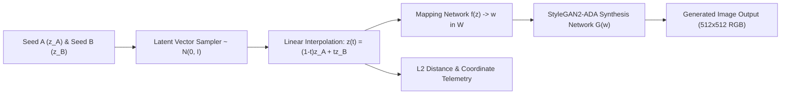

# 🧬 Latent Space Explorer — StyleGAN2

<p align="center">
  
</p>

<p align="center">
  An interactive deep learning application built with <b>Streamlit</b> and <b>PyTorch</b> for exploring continuous latent space manifolds, geodesic and linear vector interpolations ($z \in \mathcal{Z}$ and $w \in \mathcal{W}$), and high-resolution generative image synthesis using NVIDIA's <b>StyleGAN2-ADA</b> architecture.
</p>

<p align="center">
  <a href="https://github.com/prakruthidevanga/Latent_Space_Explorer_StyleGAN2">
    
  </a>
</p>

<p align="center">
  
  
  
  
</p>

---

## 📌 Table of Contents

- [📖 Project Overview](#-project-overview)
- [🎯 Objectives](#-objectives)
- [✨ Key Features](#-key-features)
- [🏗️ Generative Pipeline Architecture](#️-generative-pipeline-architecture)
- [🛠️ Technology Stack](#️-technology-stack)
- [📁 Repository Structure](#-repository-structure)
- [⚙️ Installation and Setup](#️-installation-and-setup)
- [🧪 Mathematical Verification & Unit Tests](#-mathematical-verification--unit-tests)
- [🔮 Future Enhancements](#-future-enhancements)
- [🤝 Contributing](#-contributing)
- [👩‍💻 Author & Accreditations](#-author--accreditations)

---

## 📖 Project Overview

Generative Adversarial Networks (GANs) map low-dimensional continuous probability distributions (latent space $\mathcal{Z}$) to complex high-dimensional image manifolds. **Latent Space Explorer** provides a visual and mathematical testbed to examine latent vector continuity, endpoint Euclidean distances ($L_2$), and smooth semantic transitions between generated subjects.

### Key Capabilities:
- **Dual Deterministic Latent Seeding:** Generate distinct, reproducible endpoints ($z_A, z_B \sim \mathcal{N}(0, I)$) using custom seed inputs.
- **Linear & Geodesic Interpolation:** Compute intermediate vectors using $z(t) = (1 - t) z_A + t z_B$ for continuous interpolation steps $t \in [0, 1]$.
- **Pretrained Deep Generative Synthesis:** Synthesizes realistic 512×512 images using official NVIDIA StyleGAN2-ADA PyTorch generators (default: **AFHQ Cat**, with support for **AFHQ Dog**, **AFHQ Wild**, **FFHQ**, and **MetFaces**).
- **Mathematical Diagnostics:** Real-time tracking of Euclidean $L_2$ distances, vector coordinate distributions, and intermediate gallery generation.
- **Graceful Hardware Fallback:** Automatically detects CUDA GPU acceleration while supporting CPU inference and transparent fallback messaging when checkpoints are missing.

---

## 🏗️ Generative Pipeline Architecture



---

## 🛠️ Technology Stack

<p align="center">
  
</p>

| Component | Library / Framework | Implementation Role |
| :--- | :--- | :--- |
| **Generative Framework** | PyTorch / StyleGAN2-ADA | Synthesis network execution and custom tensor operations |
| **Dashboard UI** | Streamlit | Interactive sliders, visual preview galleries, and charts |
| **Vector Mathematics** | NumPy, SciPy | Latent vector sampling, spherical interpolations, and norms |
| **Image Processing** | Pillow (PIL), Matplotlib | Dynamic image rendering and telemetry plotting |

---

## 📁 Repository Structure

```text
Latent_Space_Explorer_StyleGAN2/
├── app.py                 # Streamlit interactive UI, sliders, and visual telemetry
├── image_generator.py     # Image generation wrapper and batch interpolation logic
├── latent_utils.py        # Latent vector sampling, linear interpolation, and L2 norms
├── model_loader.py        # Pretrained StyleGAN2 checkpoint loader and device selection
├── download_model.py      # Automated model downloader (AFHQ Cat, FFHQ, MetFaces)
├── diagnostics.py         # System health checks, CUDA verification, and dependencies
├── setup_windows.ps1      # Automated PowerShell setup script for Windows
├── run_app.bat            # One-click startup batch script
├── requirements.txt       # Python dependency specifications
├── tests/
│   └── test_latent.py     # Unit tests verifying interpolation mathematics and seeds
└── screenshots/           # Application demonstration screenshots
```

---

## ⚙️ Installation and Setup

### Prerequisites
- **OS:** Windows 10/11, Linux, or macOS
- **Python:** 3.10 or 3.11 recommended for StyleGAN2-ADA compatibility
- **Hardware:** CUDA-capable NVIDIA GPU recommended for fast inference; CPU mode supported

### Step 1: Clone Repository & Create Environment
```powershell
git clone https://github.com/prakruthidevanga/Latent_Space_Explorer_StyleGAN2.git
cd Latent_Space_Explorer_StyleGAN2
python -m venv .venv
.\.venv\Scripts\Activate.ps1
```

### Step 2: Install Dependencies & Setup Third-Party Code
```powershell
pip install -r requirements.txt
Set-ExecutionPolicy -Scope Process Bypass
.\setup_windows.ps1
```

### Step 3: Download Pretrained Checkpoint
```powershell
python download_model.py --model afhqcat
```

### Step 4: Launch Streamlit Explorer
```powershell
streamlit run app.py
```
*Open `http://localhost:8501` to explore the generative latent space.*

---

## 🧪 Mathematical Verification & Unit Tests

The mathematical interpolation logic is covered by unit tests verifying endpoint preservation, linear scaling, and deterministic seeding:

```powershell
python -m unittest discover -s tests
```

---

## 🔮 Future Enhancements

- 🌐 **WebGPU / ONNX Export:** Export pruned generator models for in-browser client-side inference.
- 🎨 **Semantic Attribute Editing:** Project labeled attribute vectors (smile, age, hair color) into the intermediate $\mathcal{W}$ space.

---

## 🤝 Contributing

Contributions and pull requests are welcomed!

---

## 👩‍💻 Author & Accreditations

**Prakruthi B R**  
*BCA Student specializing in Artificial Intelligence & Machine Learning*  
*Alliance University, Bengaluru (CGPA: 9.60)*  
*GeeksforGeeks Campus Mantri (2026)*

- 💻 **GitHub:** [@prakruthidevanga](https://github.com/prakruthidevanga)
- 🔗 **LinkedIn:** [Prakruthi BR](https://linkedin.com/in/prakruthi-br)
- 🌐 **Portfolio:** [prakruthidevanga.github.io](https://prakruthidevanga.github.io/)
- 📬 **Email:** [prakruthibr2006@gmail.com](mailto:prakruthibr2006@gmail.com)

---

<p align="center">
  <b>🧬 Exploring the geometry of deep generative manifolds.</b>
</p>

<p align="center">
  
</p>
