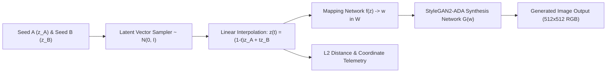

# 🧬 Latent Space Explorer — StyleGAN2

[](https://www.python.org/)
[](https://pytorch.org/)
[](https://streamlit.io/)
[](LICENSE)

An interactive deep learning application built with **Streamlit** and **PyTorch** for exploring continuous latent space manifolds, geodesic and linear vector interpolations ($z \in \mathcal{Z}$ and $w \in \mathcal{W}$), and high-resolution generative image synthesis using NVIDIA's **StyleGAN2-ADA** architecture.

---

## 📌 Project Overview

Generative Adversarial Networks (GANs) map low-dimensional continuous probability distributions (latent space $\mathcal{Z}$) to complex high-dimensional image manifolds. **Latent Space Explorer** provides a visual and mathematical testbed to examine latent vector continuity, endpoint Euclidean distances ($L_2$), and smooth semantic transitions between generated subjects.

### Key Capabilities:
- **Dual Deterministic Latent Seeding:** Generate distinct, reproducible endpoints ($z_A, z_B \sim \mathcal{N}(0, I)$) using custom seed inputs.
- **Linear & Geodesic Interpolation:** Compute intermediate vectors using $z(t) = (1 - t) z_A + t z_B$ for continuous interpolation steps $t \in [0, 1]$.
- **Pretrained Deep Generative Synthesis:** Synthesizes realistic 512×512 images using official NVIDIA StyleGAN2-ADA PyTorch generators (default: **AFHQ Cat**, with support for **AFHQ Dog**, **AFHQ Wild**, **FFHQ**, and **MetFaces**).
- **Mathematical Diagnostics:** Real-time tracking of Euclidean $L_2$ distances, vector coordinate distributions, and intermediate gallery generation.
- **Graceful Hardware Fallback:** Automatically detects CUDA GPU acceleration while supporting CPU inference and transparent fallback messaging when checkpoints are missing.

---

## 🏗️ System Architecture & Generative Pipeline



---

## 📂 Repository Structure

```text
Latent_Space_Explorer_StyleGAN2/
├── app.py                 # Streamlit interactive UI, sliders, and visual telemetry
├── image_generator.py     # Image generation wrapper and batch interpolation logic
├── latent_utils.py        # Latent vector sampling, linear interpolation, and L2 norms
├── model_loader.py        # Pretrained StyleGAN2 checkpoint loader and device selection
├── download_model.py      # Automated model downloader (AFHQ Cat, FFHQ, MetFaces)
├── diagnostics.py         # System health checks, CUDA verification, and dependencies
├── setup_windows.ps1      # Automated PowerShell setup script for Windows
├── run_app.bat            # One-click startup batch script
├── requirements.txt       # Python dependency specifications
├── tests/
│   └── test_latent.py     # Unit tests verifying interpolation mathematics and seeds
└── screenshots/           # Application demonstration screenshots
```

---

## ⚙️ Installation & Setup Instructions

### Prerequisites
- **OS:** Windows 10/11, Linux, or macOS
- **Python:** 3.10 or 3.11 recommended for StyleGAN2-ADA compatibility
- **Hardware:** CUDA-capable NVIDIA GPU recommended for fast inference; CPU mode supported

---

### Step 1: Clone Repository & Create Environment

```powershell
# Clone the repository
git clone https://github.com/prakruthidevanga/Latent_Space_Explorer_StyleGAN2.git
cd Latent_Space_Explorer_StyleGAN2

# Create and activate virtual environment
python -m venv .venv
.\.venv\Scripts\Activate.ps1
```

### Step 2: Install Dependencies & Setup Third-Party Code

```powershell
# Install required packages
pip install -r requirements.txt

# Or run the automated setup script (installs packages and clones official NVIDIA repo)
Set-ExecutionPolicy -Scope Process Bypass
.\setup_windows.ps1
```

### Step 3: Download Pretrained Checkpoint

```powershell
# Download the AFHQ Cat 512x512 pretrained model
python download_model.py --model afhqcat
```
*Supported models include: `afhqcat`, `afhqdog`, `afhqwild`, `ffhq`, and `metfaces`.*

### Step 4: Launch the Streamlit Explorer

```powershell
streamlit run app.py
```
*The interactive dashboard will open automatically at `http://localhost:8501`.*

---

## 🔬 Mathematical Verification & Unit Tests

The mathematical interpolation logic is covered by unit tests verifying endpoint preservation, linear scaling, and deterministic seeding:

```powershell
python -m unittest discover -s tests
```

---

## 🛠️ Technology Stack

- **Deep Learning Framework:** PyTorch, Torchvision
- **Generative Architecture:** NVIDIA StyleGAN2-ADA (Adaptive Discriminator Augmentation)
- **User Interface:** Streamlit, Matplotlib, PIL
- **Numerical Processing:** NumPy, SciPy

---

## 👩‍💻 Author & Contributions

- **Author:** Prakruthi B R ([@prakruthidevanga](https://github.com/prakruthidevanga))
- **Program:** BCA (Specialization in Artificial Intelligence and Machine Learning), Alliance University.
- **Contributions:** Implemented the Streamlit interactive dashboard, latent interpolation mathematical utilities, automated model downloader, and unit test suite.
